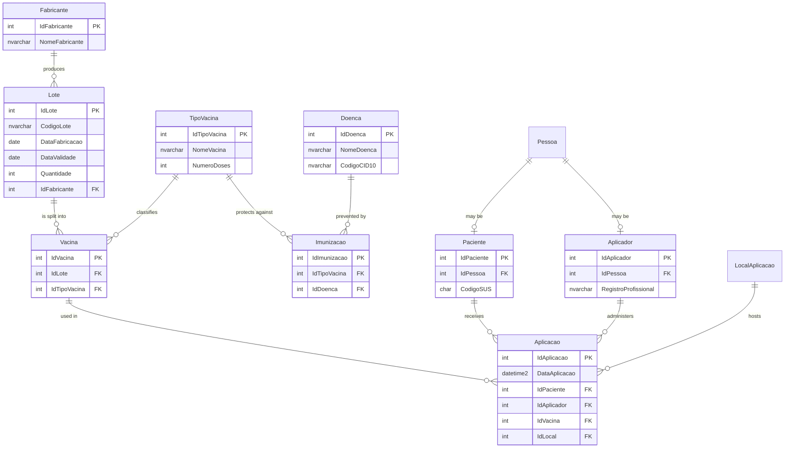
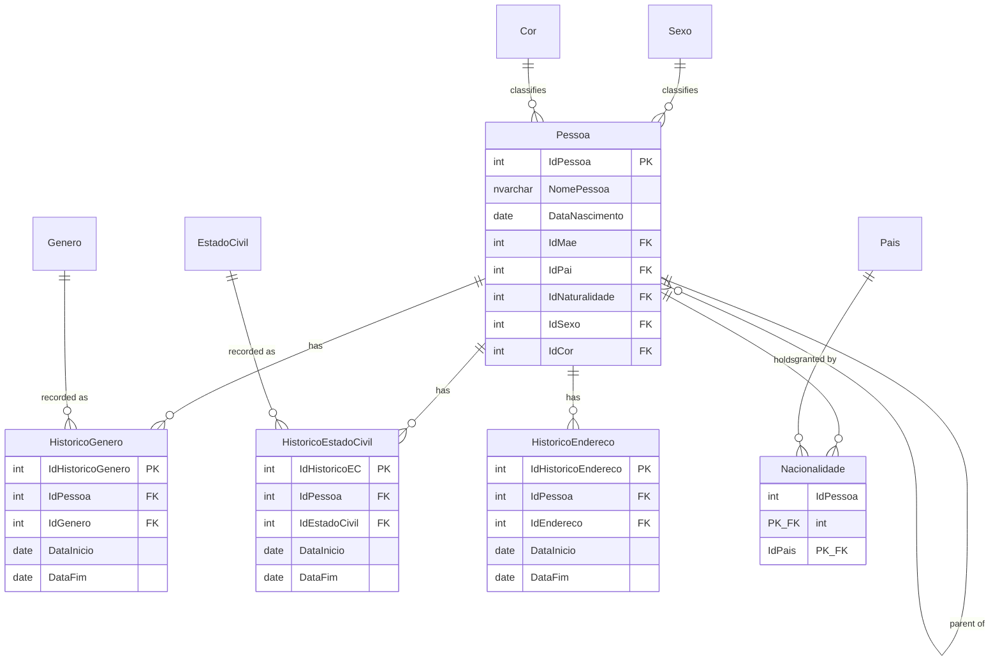
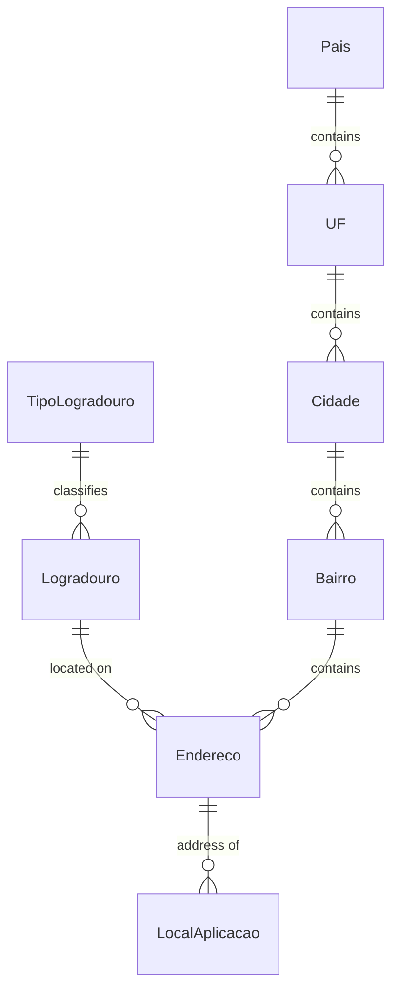

# Vaccination Record Database

Relational database modelling a national vaccination record system, built for
the Database course at UFRJ. Implemented in T-SQL on Microsoft SQL Server.

The model covers 29 tables spanning three domains: people and their historical
attributes, a normalised address hierarchy, and the vaccination chain from
manufacturer to the individual dose applied to a patient.

## Data model

### Vaccination core

### People and temporal history

### Address hierarchy

## Modelling decisions

**Temporal history instead of overwriting.** Gender, marital status and address
are not columns on `Pessoa` — each lives in its own history table with
`DataInicio` and `DataFim`, where a null end date marks the current record.
This keeps the full timeline queryable: you can ask where someone lived on the
date a given dose was applied, not just where they live now.

**Specialisation through unique foreign keys.** `Paciente` and `Aplicador` both
reference `Pessoa` under a `UNIQUE` constraint, enforcing a one-to-one
relationship. The same person can be both a patient and a health professional,
but can never be duplicated in either role.

**Self-referencing relationship.** `Pessoa.IdMae` and `Pessoa.IdPai` point back
to `Pessoa`, modelling parentage within a single table. Both are nullable, since
a record may exist without its parents registered.

**Traceability from manufacturer to patient.** `Fabricante → Lote → Vacina →
Aplicacao` makes every administered dose traceable back to a batch and a
manufacturer — which is what allows the expired-batch queries to identify
affected patients retroactively.

**Composite key for many-to-many.** `Nacionalidade` uses a composite primary key
over `(IdPessoa, IdPais)`, allowing dual nationality while preventing duplicates.

## Scripts

| File | Contents |
|---|---|
| `01-schema.sql` | DDL for all 29 tables, with primary, foreign, unique and check constraints |
| `02-seed-data.sql` | Sample data load |
| `03-table-cardinalities.sql` | Row counts per table, queried from `sys.tables` and `sys.partitions` |
| `04-subqueries.sql` | Patients vaccinated with products from every manufacturer — `GROUP BY` with `HAVING` over a correlated subquery |
| `05-transactions.sql` | `BEGIN TRANSACTION` with `COMMIT` and `ROLLBACK` demonstrations |
| `06-foreign-key-violation.sql` | Referential integrity failure on an invalid foreign key |
| `07-views.sql` | `V_LotesVencidos` — view of expired batches |
| `08-stored-procedures.sql` | `SP_PacientesComVacinaVencida` — patients who received a dose from an expired batch |
| `09-triggers.sql` | `TRG_ForcaDataAtualAplicacao` — AFTER INSERT trigger enforcing the application date |
| `10-unions.sql` | `UNION ALL` of batches expiring within 30 days and those expired in the last 30 |
| `11-full-joins.sql` | `FULL JOIN` across manufacturers, batches and vaccines, preserving nulls on both sides |
| `12-check-constraints.sql` | `CHECK` constraint on batch quantity, with the resulting violation |
| `13-temp-tables.sql` | Global temporary table (`##Fabricantes`) |
| `14-cursors.sql` | Cursor iterating a vaccination report row by row |

Run them in order — each script assumes the previous ones have been applied.

## Stack

Microsoft SQL Server · T-SQL
